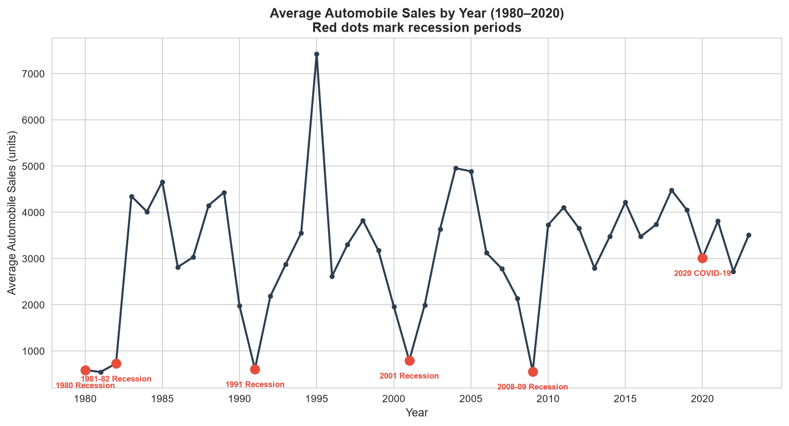

# Jinghan Mu

**Data Science Graduate Student | Aspiring Data Analyst**

---

## About Me

I'm a first-year Master's student in Data Science at the University of Macau. My interests lie in turning messy real-world data into clear, actionable stories through exploratory analysis and effective data visualization. I enjoy working with Python to clean, explore, and visualize datasets, and I'm currently building my skills in statistical analysis and machine learning.

---

## Technical Skills

| Category | Tools |
|---|---|
| **Programming** | Python, SQL, R (basic) |
| **Data Analysis** | Pandas, NumPy, SciPy |
| **Visualization** | Matplotlib, Seaborn, Plotly, Folium, Dash |
| **Machine Learning** | Scikit-learn (learning) |
| **Other** | Git/GitHub, Jupyter Notebook, Excel |

---

## Projects

### 1. Automobile Sales During Recessions — A Data Visualization Analysis

**Research Question:** How do economic recessions impact automobile sales, and which vehicle categories are most affected?

This project analyzes 40 years of monthly automobile sales data (1980–2020) across six major recession periods. Key finding: executive cars and sports vehicles experience the sharpest sales drops during economic downturns, while smaller, more affordable car segments show relative resilience. Unemployment rate and consumer confidence are strongly correlated with sales performance.

- **Repository:** [data-science-project](https://github.com/MuJinghan321/data-science-project)
- **Status:** Completed

---

## Contact

- **GitHub:** [github.com/MuJinghan321](https://github.com/MuJinghan321)
- **Email:** your.email@um.edu.mo
